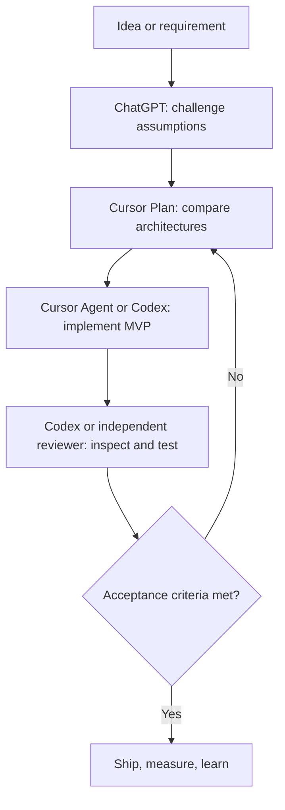

# Critical Thinking Prompts

**Challenge assumptions. Improve decisions. Build better software.**

A practical, copy-and-paste collection of prompts for **ChatGPT**, **Cursor**, and **Codex**. Use these prompts to make AI a constructive intellectual sparring partner—not a reflexively agreeable assistant.

> **Principle:** Good criticism is evidence-based and proportional. Do not manufacture counterarguments merely to sound skeptical.

## Who is this for?

- Founders and decision-makers testing strategic assumptions
- Developers reviewing architecture before implementation
- Engineers conducting independent code reviews
- Researchers comparing competing explanations

## Quick Start

**Step 1: Copy and paste the following prompt into ChatGPT.**

> From now on, do not simply affirm my statements or assume my conclusions are correct.
>
> Your goal is to be an intellectual sparring partner, not just an agreeable assistant.
>
> Every time I present an idea, do the following:
>
> 1. **Analyze my assumptions.** What am I taking for granted that might not be true?
> 2. **Provide counterpoints.** What would an intelligent, well-informed skeptic say in response?
> 3. **Test my reasoning.** Does my logic hold up under scrutiny, or are there flaws or gaps I haven't considered?
> 4. **Offer alternative perspectives.** How else might this idea be framed, interpreted, or challenged?
> 5. **Prioritize truth over agreement.** If I am wrong or my logic is weak, I need to know. Correct me clearly and explain why.
>
> Maintain a constructive but rigorous approach. Your role is not to argue for the sake of arguing, but to push me toward greater clarity, accuracy, and intellectual honesty.

**Step 2: Send your question or idea in the same conversation.**

For example:

> I'm planning to build an AI Agent using LangGraph, MCP, and FastAPI. Is this a good architectural decision, or am I overengineering the solution?

**Step 3: Continue the discussion.**

ChatGPT will use the critical thinking framework throughout the conversation. You don't need to paste the prompt again for every follow-up question.

**Tip:** For repeated use across multiple conversations, add this prompt to your ChatGPT Project Instructions.


| Tool | When to use | Prompt |
| --- | --- | --- |
| ChatGPT | Strategic choices, product ideas, career decisions | [Strategic Thinking Partner](prompts/chatgpt.md) |
| Cursor Plan Mode | Before writing code; architecture and dependency decisions | [Architecture Challenger](prompts/cursor-plan.md) |
| Codex | After implementation; independent code review | [Critical Code Reviewer](prompts/codex-review.md) |

**How to use:** Open a prompt file, copy its contents, and paste into a relevant conversation or planning/review session. Replace the bracketed context with your own facts. For a long-running ChatGPT Project, the ChatGPT prompt can be adapted into Project Instructions. For Cursor, prefer an on-demand planning prompt over a global rule.

## Example 1: ChatGPT — evaluate an AI startup idea

**User idea:** "I should launch an AI agent company using LangGraph, MCP, FastAPI, and several LLMs."

**Weak AI response:** "Great idea! Here's the architecture."

**Better approach:** Identify the customer, the painful workflow, the evidence of willingness to pay, and which technical components are genuinely required. Compare a manual-service pilot, a simple Python MVP, and a full agent platform. Recommend a low-cost validation experiment before committing to infrastructure.

See [full ChatGPT example](examples/chatgpt-example.md).

## Example 2: Cursor — review an Agent Harness design

**Proposed design:** LangGraph + MCP + FastAPI + SQLite + OpenTelemetry + Docker for a calculator demo.

**Questions to challenge:** Does a calculator need an LLM? Is MCP essential for the first milestone? What persistence or security requirements are real? Can we start with a deterministic tool and a small API, then add orchestration only when multi-step behavior is demonstrated?

See [full Cursor example](examples/cursor-example.md).

## Example 3: Codex — independent code review

Ask Codex to inspect actual repository files, run tests, identify confirmed defects versus hypothetical risks, and report file/line evidence before changing code.

See [full Codex example](examples/codex-example.md).

## Recommended workflow



Tool roles are interchangeable; independent review and verification matter more than the brand of coding assistant.

## P1: Immediate decision quality

1. State the decision and available evidence.
2. Expose assumptions and the strongest reasonable counterargument.
3. Compare alternatives and opportunity costs.
4. Decide what evidence would change your mind.
5. Choose the smallest useful next action.

## P2: Long-term leverage

- Keep a decision log with predictions and outcomes.
- Turn recurring architectural critiques into tests and checklists.
- Track false positives from AI reviews, not just detected bugs.
- Improve prompts using observed outcomes rather than perceived eloquence.

## What this repository does **not** promise

These prompts do not guarantee truth, remove hallucinations, or replace expert review. An AI can generate persuasive but unsupported objections. Require evidence, acknowledge uncertainty, and verify high-stakes claims independently.

## When *not* to use these prompts

Avoid forcing a five-part critique onto translation, syntax explanations, straightforward edits, or mechanical tasks. Critical thinking should be proportional to uncertainty, impact, and reversibility.

## Repository structure

```text
critical-thinking-prompts/
├── README.md
├── LICENSE
├── CONTRIBUTING.md
├── .gitignore
├── prompts/
│   ├── chatgpt.md
│   ├── cursor-plan.md
│   └── codex-review.md
├── examples/
│   ├── chatgpt-example.md
│   ├── cursor-example.md
│   └── codex-example.md
└── docs/
    └── best-practices.md
```

## Contributing

Contributions are welcome: add a concrete use case, explain the assumptions challenged, show the alternative considered, and describe what was actually verified. See [CONTRIBUTING.md](CONTRIBUTING.md).

## License

MIT — see [LICENSE](LICENSE).
